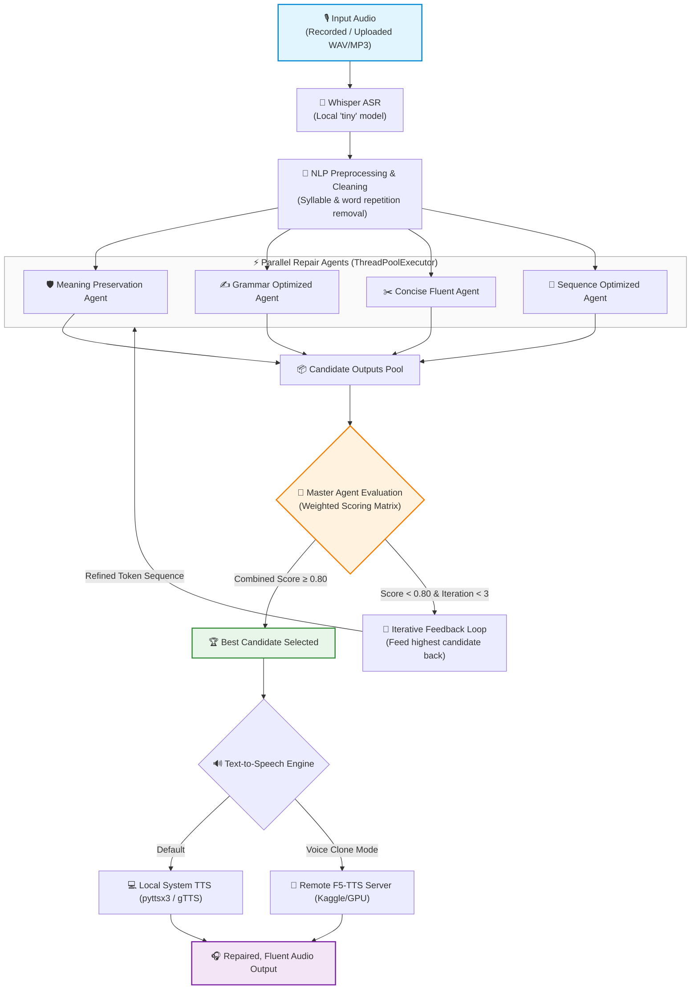

<div align="center">

# 🎙️ STEAMROLLER
### Multi-Agent Speech Repair & Fluency Enhancement Assistant

[](https://www.python.org/)
[](https://streamlit.io/)
[](https://github.com/openai/whisper)
[](https://pytorch.org/)
[](https://github.com/SWivid/F5-TTS)
[](LICENSE)

<p align="center">
  <b>Transforming speech affected by repetitions, prolongations, blocks, and fillers into clean, fluent, and natural audio.</b>
</p>

[Overview](#-overview) •
[Key Features](#-key-features) •
[Architecture](#-system-architecture) •
[Multi-Agent Design](#-multi-agent-system) •
[Master Agent & Scoring](#-master-agent--evaluation-loop) •
[Quickstart](#-installation--quickstart) •
[Voice Cloning](#-optional-f5-tts-voice-cloning) •
[Project Structure](#-project-structure) •
[Roadmap](#-limitations--future-roadmap)

---

</div>

## 📖 Overview

**STEAMROLLER** is an intelligent, multi-agent speech repair pipeline engineered to assist individuals who stutter or experience speech disfluencies. By combining robust automatic speech recognition (ASR), rule-based NLP cleaning, four specialized parallel repair agents, and a heuristic Master Agent evaluation loop, STEAMROLLER accurately repairs speech while preserving speaker intent and voice identity.

> [!NOTE]
> STEAMROLLER is designed for near real-time desktop usage with fast sub-minute processing on consumer hardware using local models, with optional zero-shot voice cloning powered by F5-TTS.

---

## ✨ Key Features

| Capability | Description |
| :--- | :--- |
| 🔁 **Repetition Removal** | Detects and resolves syllable-level (`b-b-because`), word-level (`I I I want`), and phrase-level restarts. |
| 〰️ **Prolongation Cleanup** | Normalizes sound elongations, stuttered character repeats, and phonetic blocks (`soooo` → `so`). |
| 🗣️ **Filler Word Filtering** | Filters conversational disfluencies and fillers (`uh`, `um`, `er`, `you know`, `like`, `actually`). |
| ⚡ **Parallel Multi-Agent Repair** | Concurrently generates 4 specialized repair candidates via Python's `ThreadPoolExecutor`. |
| 🧠 **Heuristic Master Agent** | Evaluates candidate quality across 4 weighted dimensions with automated feedback loops (up to 3 iterations). |
| 🧬 **Zero-Shot Voice Cloning** | Optional integration with remote **F5-TTS** backend to synthesize repaired text in the speaker's original voice. |
| 🖥️ **Interactive Streamlit UI** | Real-time audio waveform visualizer, side-by-side transcript diffs, execution logs, and audio playback. |

---

## 🏗️ System Architecture

### Pipeline Flowchart



### ASCII Architecture

```text
Input Audio
    │
    ▼
Whisper ASR
    │
    ▼
NLP Cleaning (Filler removal, Syllable & phrase deduplication)
    │
    ▼
┌────────────────────────────────────────────────────────┐
│             Parallel Repair Agents                     │
│  ├── 1. Meaning Preservation Agent                     │
│  ├── 2. Grammar Optimized Agent                        │
│  ├── 3. Concise Fluent Agent                           │
│  └── 4. Sequence Optimized Agent                       │
└────────────────────────────────────────────────────────┘
    │
    ▼
Candidate Outputs
    │
    ▼
Master Agent Evaluation
    ├── Meaning Preservation Score (50%)
    ├── Grammar Quality Score      (30%)
    ├── Concise Fluency Score      (15%)
    └── Sequence Similarity Score  (5%)
    │
    ▼
Threshold Check (Score ≥ 0.80)
    ├── [Passed]      ──► Final Selected Output
    └── [Not Met]     ──► Feedback Iteration (Max 3 cycles)
                                │
                                └──► Feed back into Parallel Agents
    │
    ▼
Text-to-Speech Engine (Local pyttsx3/gTTS or Remote F5-TTS)
    │
    ▼
Repaired, Fluent Audio
```

---

## 🤖 Multi-Agent System

Rather than relying on a single monolithic prompt, STEAMROLLER coordinates four dedicated, lightweight repair agents executing concurrently via `concurrent.futures.ThreadPoolExecutor`:

```
                                  ┌───────────────────────────────┐
                                  │   Pre-Cleaned ASR Transcript  │
                                  └──────────────┬────────────────┘
                                                 │
                   ┌─────────────────────────────┼─────────────────────────────┐
                   ▼                             ▼                             ▼
       ┌───────────────────────┐     ┌───────────────────────┐     ┌───────────────────────┐
       │  Meaning Preservation │     │   Grammar Optimized   │     │    Concise Fluent     │
       │         Agent         │     │         Agent         │     │         Agent         │
       └───────────┬───────────┘     └───────────┬───────────┘     └───────────┬───────────┘
                   │                             │                             │
                   └─────────────────────────────┼─────────────────────────────┘
                                                 ▼
                                     ┌───────────────────────┐
                                     │   Sequence Optimized  │
                                     │         Agent         │
                                     └───────────────────────┘
```

### 1. 🛡️ Meaning Preservation Agent
- **Focus**: Maximum semantic fidelity.
- **Mechanism**: Prunes low-level conversational hesitation markers (`uh`, `um`, `ah`, `er`, `you know`) while leaving sentence clauses and vocabulary intact.
- **Normalization**: Preserves sentence boundaries, normalizes casing and trailing terminal punctuation.

### 2. ✍️ Grammar Optimized Agent
- **Focus**: Structural correctness & orthography.
- **Mechanism**: Resolves split contractions (`can not` → `cannot`), missing apostrophes (`dont` → `don't`, `cant` → `can't`), and cleans awkward spacing around punctuation marks.

### 3. ✂️ Concise Fluent Agent
- **Focus**: Redundancy elimination and flow.
- **Mechanism**: Strips conversational hedges (`basically`, `actually`, `like`), deduplicates consecutive duplicate words (`I I want` → `I want`), and collapses elongated letter repetitions (`soooo` → `so`).

### 4. 🔗 Sequence Optimized Agent
- **Focus**: Stutter fragment repair & sequence smoothing.
- **Mechanism**: Resolves hyphenated syllable restart fragments from ASR (`I-I-I` or `w-w-want`), collapses repeated multi-word token sequences, and ensures proper capitalization.

---

## 🎯 Master Agent & Evaluation Loop

The **Master Agent** manages candidate evaluation, quality thresholding, and the iterative feedback loop.

### 📊 Scoring Weights & Metrics

Every candidate generated by the parallel agents is evaluated across four objective heuristic metrics:

| Metric | Weight | Measurement Strategy | Description |
| :--- | :---: | :--- | :--- |
| **Meaning Preservation** | `50%` | Character `SequenceMatcher.ratio()` | Ensures the repaired output remains semantically faithful to the original transcript. |
| **Grammar Quality** | `30%` | Capitalization, terminal punctuation, whitespace rules | Verifies sentence capitalization, terminal punctuation (`.`, `!`, `?`), and absence of double spaces or detached commas. |
| **Concise Fluency** | `15%` | Consecutive word repetition ratio ($1 - \frac{N_{repeats}}{N_{words}}$) | Penalizes stutters, redundant word loops, and unnatural repetitions. |
| **Sequence Similarity** | `5%` | Token-level `SequenceMatcher.ratio()` | Ensures natural syntactic word order is preserved between input and candidate. |

$$\text{Final Score} = 0.50 \cdot S_{\text{meaning}} + 0.30 \cdot S_{\text{grammar}} + 0.15 \cdot S_{\text{fluency}} + 0.05 \cdot S_{\text{sequence}}$$

### 🔄 The Feedback Decision Logic

1. **Threshold Assessment**: Each candidate's composite score is checked against the threshold of **`0.80`**.
2. **Success Exit**: If one or more candidates meet or exceed `0.80`, the candidate with the highest composite score is immediately selected as the final verdict.
3. **Feedback Refinement**: If no candidate reaches `0.80`, the current highest-scoring candidate text is re-tokenized and fed back into the parallel agents as the input for the next cycle.
4. **Iteration Cap**: Bounded to a maximum of **3 iterations**. If the threshold is still not met after 3 cycles, the highest-scoring candidate across all iterations is returned with status `threshold_not_met`.
5. **Execution State**: All intermediate candidate outputs, individual metric scores, and iteration trails are preserved for auditing and UI inspection.

---

## 🛠️ Technology Stack

| Category | Technologies |
| :--- | :--- |
| **Core & UI** | Python 3.10+, Streamlit |
| **Speech Recognition** | OpenAI Whisper (`tiny` default for high-speed local inference) |
| **NLP & Text Processing** | NLTK, Python `re`, `difflib.SequenceMatcher` |
| **Deep Learning & Audio** | PyTorch, NumPy, SciPy |
| **Local TTS Engines** | `pyttsx3` (Offline native OS voices), `gTTS` (Google Translate TTS) |
| **Voice Cloning** | **F5-TTS** (Non-autoregressive flow matching zero-shot TTS) |
| **Remote Backend** | Flask, pyngrok (for GPU server tunneling) |

---

## 📁 Project Structure

```text
Steamroller_Refactored/
├── app.py                      # Streamlit interactive frontend
├── pipeline.py                 # Core headless pipeline orchestrator
├── requirements.txt            # Local Python dependencies
├── .env.example                # Example configuration and environment template
├── .gitignore                  # Git ignore rules for caches, .env, and runtime audio
├── config/
│   ├── __init__.py
│   └── settings.py             # Centralized settings & environment loader
├── asr/
│   ├── __init__.py
│   └── whisper_asr.py          # OpenAI Whisper speech-to-text inference
├── nlp/
│   ├── __init__.py
│   └── cleaner.py              # Stutter pattern, syllable repeat & filler removal
├── agents/
│   ├── __init__.py
│   └── repair_agents.py        # 4 specialized repair agents + heuristic evaluator
├── services/
│   ├── __init__.py
│   └── kaggle_gpu.py           # Kaggle API kernel auto-launch & health service
├── tts/
│   ├── __init__.py
│   └── f5_tts_client.py        # Zero-shot F5-TTS remote client
├── ui/
│   ├── __init__.py
│   ├── recorder.py             # Audio input recorder & upload handling
│   └── styles.py               # Modern responsive CSS styles
├── utils/
│   ├── __init__.py
│   ├── audio_utils.py          # Audio format conversion & normalization
│   └── errors.py               # Typed exception hierarchy
├── kaggle_server/
│   ├── f5_tts_server.py        # Production FastAPI server script for Kaggle cell
│   └── final-f5tts.ipynb       # Jupyter notebook for Kaggle GPU environment
├── outputs/                    # Runtime synthesized audio output directory
└── uploads/                    # Runtime user recording upload directory
```

### Main Components Overview

- [app.py](file:///d:/Projects/Steamroller_f5tts%20(2)/Steamroller_Refactored/app.py): Streamlit dashboard with file uploader, microphone recorder, audio player, status tracking, and error boundaries.
- [pipeline.py](file:///d:/Projects/Steamroller_f5tts%20(2)/Steamroller_Refactored/pipeline.py): Standalone orchestrator coordinating Whisper ASR, NLP cleaning, multi-agent repair, and F5-TTS synthesis.
- [settings.py](file:///d:/Projects/Steamroller_f5tts%20(2)/Steamroller_Refactored/config/settings.py): Centralized environment and configuration settings loaded via `python-dotenv`.
- [whisper_asr.py](file:///d:/Projects/Steamroller_f5tts%20(2)/Steamroller_Refactored/asr/whisper_asr.py): Whisper speech recognition engine decoding raw audio into transcript text.
- [cleaner.py](file:///d:/Projects/Steamroller_f5tts%20(2)/Steamroller_Refactored/nlp/cleaner.py): Rule-based NLP cleaner detecting syllable stutters (`b-b-`), repetitions, and fillers.
- [repair_agents.py](file:///d:/Projects/Steamroller_f5tts%20(2)/Steamroller_Refactored/agents/repair_agents.py): Parallel repair agents and heuristic Master Agent evaluator.
- [kaggle_gpu.py](file:///d:/Projects/Steamroller_f5tts%20(2)/Steamroller_Refactored/services/kaggle_gpu.py): Kaggle GPU kernel service with health checks, auto-discovery, and auto-launch.
- [f5_tts_client.py](file:///d:/Projects/Steamroller_f5tts%20(2)/Steamroller_Refactored/tts/f5_tts_client.py): HTTP client transmitting audio and text to the remote F5-TTS backend.
- [f5_tts_server.py](file:///d:/Projects/Steamroller_f5tts%20(2)/Steamroller_Refactored/kaggle_server/f5_tts_server.py): FastAPI GPU server with resident F5-TTS model and pyngrok tunnel.

---

## 🚀 Installation & Quickstart

### Prerequisites
- Python `3.10` or higher
- `ffmpeg` installed on your system (required for Whisper audio decoding)

### 1. Clone & Install Dependencies

```bash
# Clone the repository
git clone https://github.com/AdityaSuryakar/MegaProject-STEAMROLLER.git
cd MegaProject-STEAMROLLER/Steamroller_Refactored

# Create a virtual environment (recommended)
python -m venv venv
# On Windows:
.\venv\Scripts\activate
# On Linux/macOS:
source venv/bin/activate

# Install dependencies
pip install -r requirements.txt
```

### 2. Launch Streamlit Application

```bash
streamlit run app.py
```

> [!TIP]
> **Performance Recommendation**: For fast sub-minute processing on consumer laptops, audio recordings between **5 and 30 seconds** are recommended.

---

## 🧬 Optional F5-TTS Voice Cloning

By default, STEAMROLLER uses local offline TTS (`pyttsx3` or `gTTS`). If you want the repaired audio to sound identical to the user's natural voice, you can connect STEAMROLLER to an external **F5-TTS** GPU backend.

```
┌───────────────────────────┐                     ┌───────────────────────────────┐
│     Local STEAMROLLER     │                     │     Remote GPU Host (Kaggle)  │
│  (Streamlit on localhost) │                     │  (F5-TTS Model + ngrok tunnel)│
└─────────────┬─────────────┘                     └───────────────┬───────────────┘
              │                                                   │
              │  POST /clone-voice                                │
              │  { "ref_audio": "...", "gen_text": "..." }        │
              ├──────────────────────────────────────────────────►│
              │                                                   │
              │  WAV Audio Stream                                 │
              │◄──────────────────────────────────────────────────┤
```

### Step-by-Step Setup

1. **Start Kaggle/Colab GPU Notebook**:
   - Open a Kaggle notebook and enable a GPU accelerator (T4 or P100).
   - Copy the code from [kaggle_server_cell.py](file:///d:/Projects/Steamroller_f5tts%20(2)/Steamroller/kaggle_server_cell.py) into a notebook cell after installing F5-TTS.
   - Run the cell — it will spin up a Flask server and display a public ngrok tunnel URL (e.g. `https://abcd-1234.ngrok-free.app`).

2. **Set the Environment Variable**:
   
   **Windows PowerShell:**
   ```powershell
   $env:KAGGLE_TTS_URL="https://YOUR-NGROK-URL.ngrok-free.app"
   streamlit run app.py
   ```

   **Linux / macOS (Bash):**
   ```bash
   export KAGGLE_TTS_URL="https://YOUR-NGROK-URL.ngrok-free.app"
   streamlit run app.py
   ```

3. **Select Voice in App**:
   - In the Streamlit sidebar, select **"F5-TTS Voice Clone"** as the TTS output engine.
   - STEAMROLLER will transmit the original audio as reference and synthesize the repaired text in the speaker's cloned voice!

---

## 📈 Evaluation & State Tracking

STEAMROLLER maintains full execution state throughout each session for diagnostic and research transparency:

- 📝 **Original Raw Transcript**: Initial transcription produced by Whisper ASR.
- 🧹 **Cleaned Transcript**: Pre-processed text after regex and syllable deduplication.
- 📦 **Per-Iteration Candidate Pool**: Outputs generated by each of the 4 agents.
- 📊 **Fine-Grained Score Breakdown**: Meaning (50%), Grammar (30%), Fluency (15%), Sequence (5%).
- 🏆 **Final Selection & Iteration Count**: Detailed reasoning and final convergence status (`success` vs `threshold_not_met`).

---

### Future Roadmap
- [ ] **LLM-Powered Repair Agents**: Introduce a small quantized local LLM (e.g., Llama 3 8B or Mistral 7B) for context-aware pragmatic repair.
- [ ] **Learned Speech-Repair Metrics**: Train a neural sentence fluency scorer calibrated on human perception ratings.
- [ ] **Real-Time Streaming Pipeline**: Stream audio chunks with sub-second latency using WebRTC and streaming ASR.
- [ ] **Expanded Disfluency Benchmarking**: Evaluate against open-source stutter datasets (e.g., SEP-28k, FluencyBank) for rigorous quantitative validation.

---

<div align="center">

Built with ❤️ for accessible, fluent, and empowering speech communication.

</div>
