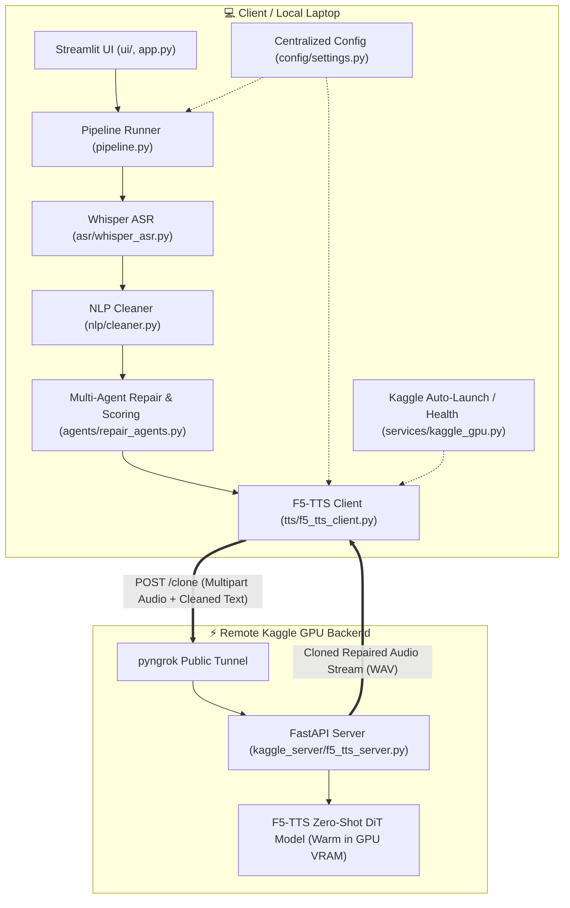

<div align="center">

# 🎙️ STEAMROLLER (Refactored)
### Multi-Agent Speech Repair & Zero-Shot F5-TTS Voice Cloning Architecture

[](https://www.python.org/)
[](https://streamlit.io/)
[](https://github.com/openai/whisper)
[](https://pytorch.org/)
[](https://github.com/SWivid/F5-TTS)
[](https://fastapi.tiangolo.com/)

<p align="center">
  <b>Decoupled, modular multi-agent pipeline transforming stuttered or disfluent speech into fluent, natural speech synthesized in the speaker's own cloned voice.</b>
</p>

---

</div>

## 📌 Architecture Highlights

This refactored architecture provides complete separation of concerns between UI, orchestration, ASR, NLP cleaning, multi-agent repair, and remote GPU voice cloning services:



---

## 📁 Directory Structure

```text
Steamroller_Refactored/
├── app.py                      # Streamlit interactive frontend
├── pipeline.py                 # Core headless pipeline orchestrator
├── requirements.txt            # Local Python dependencies
├── .env.example                # Example configuration and environment template
├── .gitignore                  # Git ignore rules for caches, .env, and runtime audio
├── config/
│   ├── __init__.py
│   └── settings.py             # Centralized settings & environment loader
├── asr/
│   ├── __init__.py
│   └── whisper_asr.py          # OpenAI Whisper speech-to-text inference
├── nlp/
│   ├── __init__.py
│   └── cleaner.py              # Stutter pattern, syllable repeat & filler removal
├── agents/
│   ├── __init__.py
│   └── repair_agents.py        # 4 specialized repair agents + heuristic evaluator
├── services/
│   ├── __init__.py
│   └── kaggle_gpu.py           # Kaggle API kernel auto-launch & health service
├── tts/
│   ├── __init__.py
│   └── f5_tts_client.py        # Zero-shot F5-TTS remote client
├── ui/
│   ├── __init__.py
│   ├── recorder.py             # Audio input recorder & upload handling
│   └── styles.py               # Modern responsive CSS styles
├── utils/
│   ├── __init__.py
│   ├── audio_utils.py          # Audio format conversion & normalization
│   └── errors.py               # Typed exception hierarchy
├── kaggle_server/
│   ├── f5_tts_server.py        # Production FastAPI server script for Kaggle cell
│   └── final-f5tts.ipynb       # Jupyter notebook for Kaggle GPU environment
├── outputs/                    # Runtime synthesized audio output directory
└── uploads/                    # Runtime user recording upload directory
```

---

## 🚀 Quickstart Guide

### 1. Prerequisites
- Python 3.10+
- `ffmpeg` installed on your PATH

### 2. Install Dependencies
```bash
cd Steamroller_Refactored
python -m venv venv

# On Windows:
.\venv\Scripts\activate
# On Linux/macOS:
source venv/bin/activate

pip install -r requirements.txt
```

### 3. Environment Configuration
Copy `.env.example` to `.env`:
```bash
cp .env.example .env
```

Set your Kaggle ngrok endpoint in `.env`:
```ini
KAGGLE_TTS_URL="https://YOUR-NGROK-SUBDOMAIN.ngrok-free.dev"
```

Optional Kaggle API credentials for auto-launch:
```ini
KAGGLE_USERNAME="your-username"
KAGGLE_KEY="your-api-key"
```

### 4. Run the Streamlit Application
```bash
streamlit run app.py
```

---

## ☁️ Setting Up the Kaggle F5-TTS GPU Backend

1. Open Kaggle and create a new notebook with **GPU Accelerator (T4 x2 or P100)** enabled.
2. Open `kaggle_server/final-f5tts.ipynb` or paste the contents of `kaggle_server/f5_tts_server.py` as the execution cell.
3. Add your `NGROK_AUTH_TOKEN` under **Add-ons → Secrets**.
4. Run the notebook cell to launch the FastAPI server.
5. Copy the printed ngrok public URL into your `.env` as `KAGGLE_TTS_URL`.
